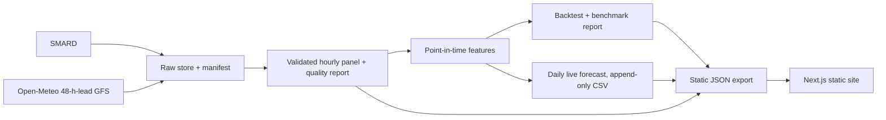

# GridMind AI

**Point-in-time day-ahead electricity load forecasts for Germany–Luxembourg, benchmarked against the grid operators' own forecast, on open data.**

> **Status:** data pipeline, load and renewables forecasts with a frozen test year, static web app and CI are in place. Storage dispatch and control-area forecasts are in place. The static site is live at [gridmind-ai-bice.vercel.app](https://gridmind-ai-bice.vercel.app).

## What it does

1. **Observe:** hourly load for DE-LU and the four German TSO control areas (with their own reconciled forecasts), the generation mix, and a day × hour "load carpet". Missing data is shown as missing, never as zero.
2. **Predict:** every day, forecast each hour of tomorrow's load **at 10:00 the day before**. This is the same deadline by which the transmission system operators (TSOs) must publish their own forecast, so the comparison is fair. Inputs are only data that existed at that moment: load published at least 2 hours earlier, the GFS temperature forecast made 48 hours before each hour, and the calendar. Forecasts come with calibrated 50% and 90% intervals.
3. **Prove it:** a rolling-origin backtest with a frozen test year (Nov 2025 – Oct 2026) evaluated once, Diebold–Mariano significance tests against the TSO forecast, a hindsight-weather "oracle" upper bound, and a **live, append-only track record** committed to git.

**Result on the frozen test year (Nov 2025 – Oct 2026, 8,757 hours, evaluated once):**

- GridMind's MAE is 1,598 MW (3.0%) against 2,068 MW (3.9%) for the TSOs' official forecast: **22.7% lower error** (Diebold–Mariano p < 0.0001).
- 90% intervals cover 90.0% of hours.

Renewables: the TSOs' own forecasts, published 8 h later, are still more accurate. Weather at wind-farm and offshore sites at 100 m height cut GridMind's wind errors by 23% (onshore) and 30% (offshore). This was evaluated as a second look at the same test year and is labelled as such. See [docs/reports/renewables_benchmark.md](docs/reports/renewables_benchmark.md).

**Storage Lab:** forecasts turned into decisions. A 2 GW / 8 GWh storage fleet is scheduled each day (a linear program) to shave the peak of residual load. Planned on TSO forecasts it captures 69% of the perfect-foresight peak reduction; on GridMind's load + TSO renewables, 68%; with GridMind's own renewables, 49%. Renewable forecast quality dominates the value. See [docs/reports/storage_benchmark.md](docs/reports/storage_benchmark.md).

**Control areas:** separate forecasts for the four TSO control areas and Germany, reconciled so they add up (MinT with shrinkage, chosen on validation data). They beat each TSO's own area forecast on the test year by 14–55% MAE. See [docs/reports/control_area_benchmark.md](docs/reports/control_area_benchmark.md).

Full load report: **[docs/reports/load_benchmark.md](docs/reports/load_benchmark.md)** (generated; every number traces to a run manifest).

## Quick start

Requires `uv` (Python 3.12+) and Node 24+. No API keys.

```bash
make setup          # Python + web dependencies
make test lint      # unit/integration tests, ruff, eslint, tsc (+ `npx playwright test` in apps/web)
make ingest         # SMARD (about 11k small files, cached) + Open-Meteo weather (a few calls); incremental
make panel          # hourly panel, calendar, data-quality report -> docs/QUALITY_REPORT.md
make features backtest   # point-in-time features, backtest, docs/reports/load_benchmark.md
make export web-build    # JSON for the site, static build in apps/web/out
make screenshots    # light/dark, desktop/mobile screenshots of the built site
make live           # issue tomorrow's forecast and append it to track_record/live_forecasts.csv
uv run gridmind status   # freshness checks; exits 1 if data or the live forecast is stale
```

## Data and licences

| Source | Licence | Used for |
|---|---|---|
| [SMARD](https://www.smard.de) (Bundesnetzagentur, data from ENTSO-E) | CC BY 4.0, "Bundesnetzagentur \| SMARD.de" | Actual load, TSO day-ahead load forecast, generation by type |
| Weather data by [Open-Meteo.com](https://open-meteo.com) (NOAA GFS, Previous Runs API) | CC BY 4.0; free API non-commercial | Temperature forecasts made 48 h before each hour (model input); lead-0 values (oracle only) |
| [Natural Earth](https://www.naturalearthdata.com) | Public domain | State boundaries for the map |

GridMind needs no credentials and uses only these three openly licensed sources. Each one is attributed in the app and in every exported file.

- **Attribution:** "[Bundesnetzagentur | SMARD.de](https://www.smard.de)" and "[Weather data by Open-Meteo.com](https://open-meteo.com/)", both under [CC BY 4.0](https://creativecommons.org/licenses/by/4.0/); [Natural Earth](https://www.naturalearthdata.com) (public domain). The site credits them, with links, on every page.
- **Changes made:** GridMind converts units (MWh per interval to MW), aggregates to hours, weights weather by population or area, and builds forecasts on top. The published numbers are derived data, not the providers' originals, and no endorsement by the providers is implied.
- **Non-commercial:** Open-Meteo's free API is for non-commercial use only; this project is a non-commercial research portfolio.
- **No price data.** Wholesale prices are deliberately left out. SMARD states that the licensing of its price series is under review, and other price sources need registration or a commercial licence. Storage is therefore valued on residual load (peak reduction), not on revenue.

## How it is built



- **Python:** uv, Polars, DuckDB views, scikit-learn (HistGradientBoosting quantile models with conformal calibration), Typer CLI.
- **Web:** Next.js (static export), Tailwind, ECharts, Playwright. No server: the frontend only renders numbers the pipeline exported.
- **Contracts:** [docs/DATA_CONTRACT.md](docs/DATA_CONTRACT.md) (issue time, availability rules, units, DST).

## Limits, stated plainly

- Load is the TSOs' measured grid load, not household consumption. Rooftop solar used on site lowers it.
- Historical actuals are SMARD's latest revised values, so backtest lag features are slightly better than what was known in real time; the live track record measures that gap.
- The control-area map shapes are approximations by federal state.
- This is research output: not for grid operation, trading or safety-critical use.

## Licence

The code is released under the [MIT Licence](LICENSE). The data keeps its own licences: SMARD and Open-Meteo data under [CC BY 4.0](https://creativecommons.org/licenses/by/4.0/), Natural Earth in the public domain. The derived data files in `apps/web/public/data/`, `docs/reports/` and `tests/fixtures/` are redistributed under those terms, with the attribution and change notes above.
