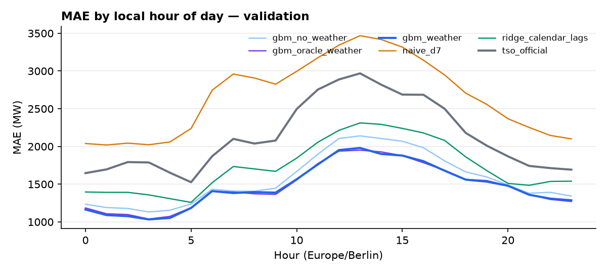
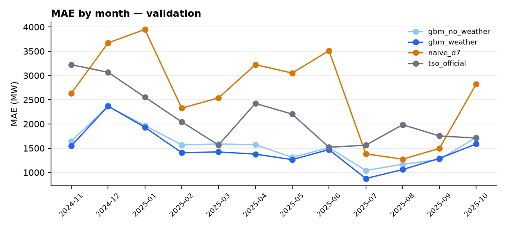
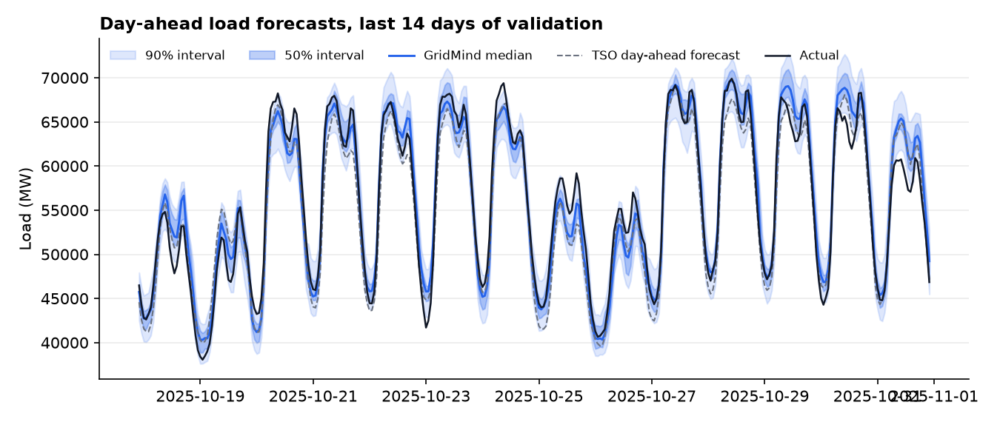
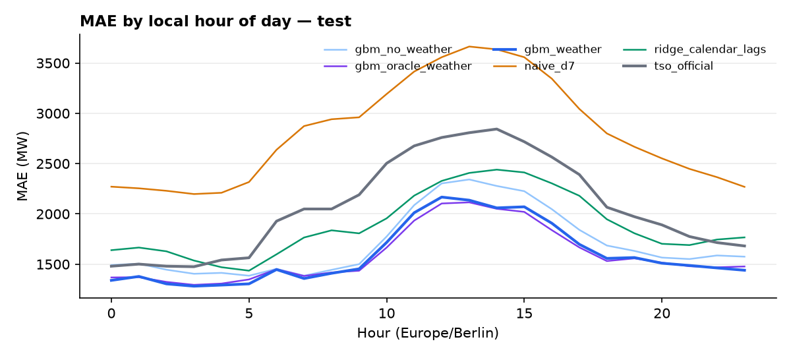
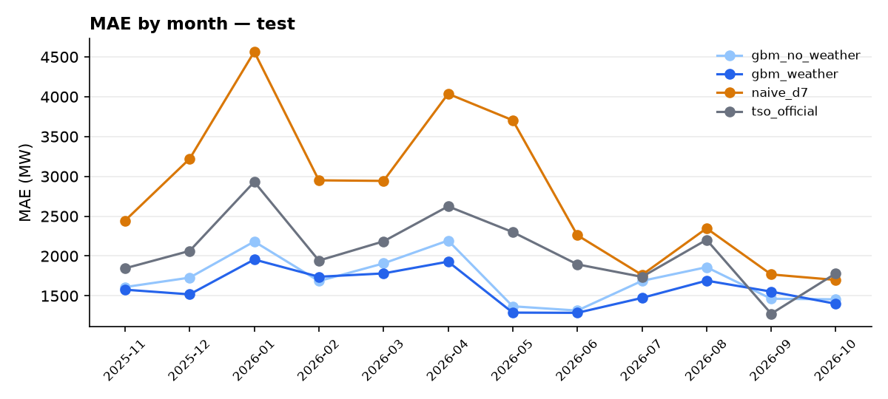
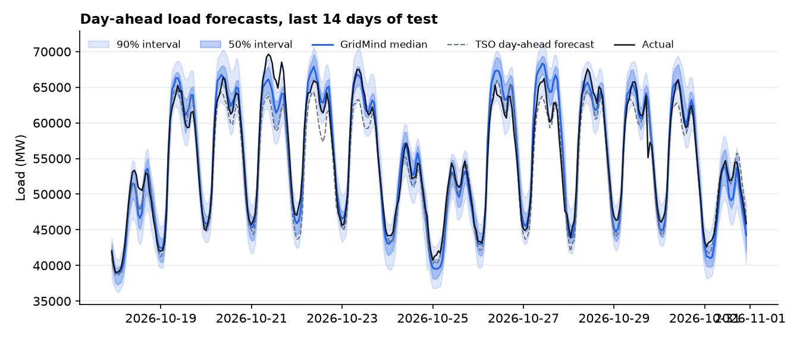

# Day-ahead load forecast benchmark (DE-LU)

_Generated by `gridmind backtest`. Do not edit by hand; numbers come from the run manifests below._

**Setup.**
- Forecasts are issued at D-1 10:00 Europe/Berlin (the TSO publication deadline) for each hour of D.
- Weather comes from the GFS run available at issue time; load lags are only those known at issue time.
- Models are refit monthly with expanding windows. The test year was evaluated once, with hyperparameters fixed beforehand.
- Scored hours are those where the target, the TSO forecast and every model exist.
- Skill = 1 − MAE / MAE(TSO). The DM test uses daily mean absolute errors with Newey-West variance (negative = first model better).
- `gbm_oracle_weather` uses GFS *analysis* (hindsight) weather: an upper bound, **not** an operational forecast.

## Validation period: 2024-11-01 → 2025-10-31

Run id `7f661332ec61` · scored hours: 8,757

| model | label | mae_mw | rmse_mw | bias_mw | mape_pct | peak_mae_mw | skill_vs_tso | pinball_mean_mw | coverage_50 | coverage_90 | width_90_mw |
|---|---|---|---|---|---|---|---|---|---|---|---|
| gbm_weather | operational | 1,468 | 2,009 | -195 | 2.73 | 1,697 | +31.2% | 476 | 0.513 | 0.886 | 6,193 |
| gbm_oracle_weather | hindsight_oracle | 1,469 | 1,994 | -150 | 2.74 | 1,678 | +31.2% | 471 | 0.509 | 0.888 | 6,196 |
| gbm_no_weather | operational | 1,561 | 2,092 | -93 | 2.91 | 1,750 | +26.8% | 497 | 0.506 | 0.887 | 6,356 |
| ridge_calendar_lags | operational | 1,732 | 2,371 | +258 | 3.30 | 1,761 | +18.8% | 569 | 0.447 | 0.868 | 6,698 |
| tso_official | official benchmark | 2,133 | 2,689 | -13 | 4.02 | 2,170 | +0.0% | — | — | — | — |
| naive_holiday_adjusted | operational | 2,315 | 3,257 | -124 | 4.35 | 2,387 | -8.5% | 763 | 0.446 | 0.886 | 9,202 |
| naive_d7 | operational | 2,659 | 4,048 | -87 | 5.03 | 2,912 | -24.6% | 915 | 0.445 | 0.891 | 10,641 |
| naive_d2 | operational | 6,246 | 8,161 | -11 | 11.94 | 7,211 | -192.8% | 2,019 | 0.515 | 0.919 | 29,381 |

**Significance (Diebold–Mariano)**

| model | vs | dm_stat | p_value | n_days |
|---|---|---|---|---|
| gbm_weather | tso_official | -6.04 | 0.0000 | 365 |
| gbm_weather | gbm_no_weather | -4.36 | 0.0000 | 365 |
| gbm_weather | naive_d7 | -6.90 | 0.0000 | 365 |
| gbm_no_weather | tso_official | -5.24 | 0.0000 | 365 |

**MAE by daily-mean forecast temperature**

| model | temp_bin | mae | hours |
|---|---|---|---|
| gbm_no_weather | 0–10°C | 1,833 | 3598 |
| gbm_no_weather | 10–20°C | 1,363 | 3983 |
| gbm_no_weather | <0°C | 1,464 | 192 |
| gbm_no_weather | ≥20°C | 1,388 | 984 |
| gbm_oracle_weather | 0–10°C | 1,724 | 3598 |
| gbm_oracle_weather | 10–20°C | 1,273 | 3983 |
| gbm_oracle_weather | <0°C | 1,546 | 192 |
| gbm_oracle_weather | ≥20°C | 1,310 | 984 |
| gbm_weather | 0–10°C | 1,731 | 3598 |
| gbm_weather | 10–20°C | 1,282 | 3983 |
| gbm_weather | <0°C | 1,403 | 192 |
| gbm_weather | ≥20°C | 1,270 | 984 |
| naive_d7 | 0–10°C | 2,961 | 3598 |
| naive_d7 | 10–20°C | 2,589 | 3983 |
| naive_d7 | <0°C | 3,322 | 192 |
| naive_d7 | ≥20°C | 1,705 | 984 |
| ridge_calendar_lags | 0–10°C | 1,883 | 3598 |
| ridge_calendar_lags | 10–20°C | 1,667 | 3983 |
| ridge_calendar_lags | <0°C | 1,936 | 192 |
| ridge_calendar_lags | ≥20°C | 1,403 | 984 |
| tso_official | 0–10°C | 2,457 | 3598 |
| tso_official | 10–20°C | 1,902 | 3983 |
| tso_official | <0°C | 2,484 | 192 |
| tso_official | ≥20°C | 1,815 | 984 |

**Holidays vs regular days**

| model | day_type | mae | hours |
|---|---|---|---|
| gbm_no_weather | holiday | 1,630 | 264 |
| gbm_no_weather | regular | 1,559 | 8493 |
| gbm_oracle_weather | holiday | 1,579 | 264 |
| gbm_oracle_weather | regular | 1,465 | 8493 |
| gbm_weather | holiday | 1,626 | 264 |
| gbm_weather | regular | 1,463 | 8493 |
| naive_d7 | holiday | 9,883 | 264 |
| naive_d7 | regular | 2,434 | 8493 |
| ridge_calendar_lags | holiday | 4,294 | 264 |
| ridge_calendar_lags | regular | 1,652 | 8493 |
| tso_official | holiday | 1,990 | 264 |
| tso_official | regular | 2,138 | 8493 |

## Test period: 2025-11-01 → 2026-10-31

Run id `e9a3c0caf63f` · scored hours: 8,757

| model | label | mae_mw | rmse_mw | bias_mw | mape_pct | peak_mae_mw | skill_vs_tso | pinball_mean_mw | coverage_50 | coverage_90 | width_90_mw |
|---|---|---|---|---|---|---|---|---|---|---|---|
| gbm_oracle_weather | hindsight_oracle | 1,589 | 2,042 | +79 | 2.96 | 1,658 | +23.2% | 502 | 0.510 | 0.897 | 6,929 |
| gbm_weather | operational | 1,598 | 2,051 | +68 | 2.98 | 1,664 | +22.7% | 505 | 0.505 | 0.900 | 6,905 |
| gbm_no_weather | operational | 1,705 | 2,202 | +20 | 3.19 | 1,767 | +17.5% | 536 | 0.515 | 0.905 | 7,300 |
| ridge_calendar_lags | operational | 1,885 | 2,557 | +170 | 3.56 | 1,874 | +8.8% | 621 | 0.435 | 0.851 | 6,916 |
| tso_official | official benchmark | 2,068 | 2,677 | +274 | 3.88 | 2,051 | +0.0% | — | — | — | — |
| naive_holiday_adjusted | operational | 2,554 | 3,480 | -30 | 4.75 | 2,653 | -23.5% | 831 | 0.406 | 0.867 | 9,417 |
| naive_d7 | operational | 2,809 | 4,061 | +35 | 5.25 | 3,033 | -35.8% | 939 | 0.406 | 0.888 | 10,831 |
| naive_d2 | operational | 6,278 | 8,110 | +19 | 11.92 | 7,221 | -203.6% | 2,013 | 0.495 | 0.922 | 29,068 |

**Significance (Diebold–Mariano)**

| model | vs | dm_stat | p_value | n_days |
|---|---|---|---|---|
| gbm_weather | tso_official | -6.05 | 0.0000 | 365 |
| gbm_weather | gbm_no_weather | -4.32 | 0.0000 | 365 |
| gbm_weather | naive_d7 | -6.28 | 0.0000 | 365 |
| gbm_no_weather | tso_official | -4.76 | 0.0000 | 365 |

**MAE by daily-mean forecast temperature**

| model | temp_bin | mae | hours |
|---|---|---|---|
| gbm_no_weather | 0–10°C | 1,793 | 3478 |
| gbm_no_weather | 10–20°C | 1,581 | 3479 |
| gbm_no_weather | <0°C | 2,275 | 408 |
| gbm_no_weather | ≥20°C | 1,630 | 1392 |
| gbm_oracle_weather | 0–10°C | 1,687 | 3478 |
| gbm_oracle_weather | 10–20°C | 1,464 | 3479 |
| gbm_oracle_weather | <0°C | 1,937 | 408 |
| gbm_oracle_weather | ≥20°C | 1,553 | 1392 |
| gbm_weather | 0–10°C | 1,664 | 3478 |
| gbm_weather | 10–20°C | 1,489 | 3479 |
| gbm_weather | <0°C | 2,182 | 408 |
| gbm_weather | ≥20°C | 1,536 | 1392 |
| naive_d7 | 0–10°C | 3,040 | 3478 |
| naive_d7 | 10–20°C | 2,436 | 3479 |
| naive_d7 | <0°C | 6,544 | 408 |
| naive_d7 | ≥20°C | 2,068 | 1392 |
| ridge_calendar_lags | 0–10°C | 1,925 | 3478 |
| ridge_calendar_lags | 10–20°C | 1,718 | 3479 |
| ridge_calendar_lags | <0°C | 4,127 | 408 |
| ridge_calendar_lags | ≥20°C | 1,548 | 1392 |
| tso_official | 0–10°C | 2,037 | 3478 |
| tso_official | 10–20°C | 2,083 | 3479 |
| tso_official | <0°C | 3,468 | 408 |
| tso_official | ≥20°C | 1,696 | 1392 |

**Holidays vs regular days**

| model | day_type | mae | hours |
|---|---|---|---|
| gbm_no_weather | holiday | 2,047 | 264 |
| gbm_no_weather | regular | 1,695 | 8493 |
| gbm_oracle_weather | holiday | 1,671 | 264 |
| gbm_oracle_weather | regular | 1,586 | 8493 |
| gbm_weather | holiday | 1,779 | 264 |
| gbm_weather | regular | 1,593 | 8493 |
| naive_d7 | holiday | 8,423 | 264 |
| naive_d7 | regular | 2,634 | 8493 |
| ridge_calendar_lags | holiday | 4,786 | 264 |
| ridge_calendar_lags | regular | 1,795 | 8493 |
| tso_official | holiday | 2,290 | 264 |
| tso_official | regular | 2,061 | 8493 |

